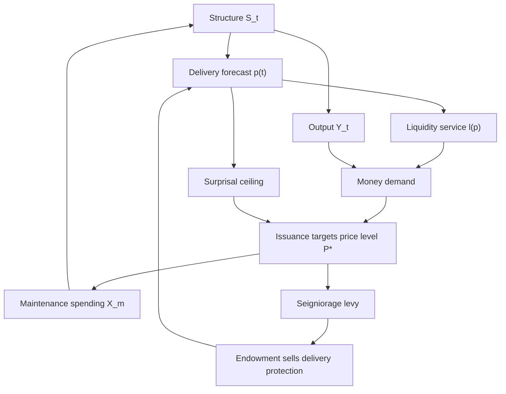

# Prompt: Build the "Surprisal Money" repository (v2)

You are an agent tasked with creating and iterating on a small research repository. The repository explores a monetary design in which the currency is credit against future delivery of *useful work*, in which money demand rises with the market-priced probability that the credit will be made good, and in which issuance is set mechanically to hold a price level subject to a ceiling on the information-theoretic *surprisal of delivery*. Read this whole document before writing anything. Where the spec is silent, prefer the simplest choice that keeps the model honest, and record the choice in `docs/DECISIONS.md`.

This document supersedes `SURPRISAL_MONEY_PROMPT.md` (v1). v1 contained two errors that made its model degenerate and four that made it misleading; Appendix A records what changed and why. Do not build from v1. Do not silently re-import v1's equations.

The repository must contain these deliverables:

1. `README.md`: a short explainer and rationale for a general technical reader.
2. `docs/MODEL.md`: the in-depth explainer that captures the model in section 3, with equations.
3. `docs/PRIOR_ART.md`: section 5, organised by the objection each source raises.
4. `docs/OPEN_PROBLEMS.md`: section 6.
5. `docs/DECISIONS.md`: every choice made where this prompt was silent.
6. `docs/REFERENCES.md`: the bibliography, containing only entries you have verified exist.
7. `docs/IDEAS.md`: section 10 — adjacent constructions and research directions, graded, and explicitly fenced off from the model.
8. `sim/`: a runnable simulation of the single-issuer economy, with a two-issuer extension.

Do not overclaim. This is a toy model intended to make a conceptual argument precise, not a proposal that is ready for anything. Do not invent empirical numbers, historical precedents, or institutional endorsements. Where a claim is a conjecture, label it as one. Where a simulation result contradicts the narrative in this prompt, report the contradiction and change the narrative, not the result.

---

## 0. What the design is trying to do

The target is a monetary system that actively protects the future that issues it. Three requirements define it:

**Full credit protection, priced down the term structure.** Modern money is credit. The design asks that the institutions issuing it continuously price the probability that the credit will be made good, at every maturity, and wire that price into the issuance decision — in a direction such that high probability is *expansionary*. Not a brake that clamps down in bad times, but a mechanism in which confidence and capacity reinforce each other.

**Money as a proxy for free energy, not free energy itself.** Energy is conserved, so energy is not the scarce thing. The scarce thing is *exergy* — energy in a form from which work can still be extracted. But exergy is not directly usable as money either: it must be delivered, stored, and transformed, and its availability fluctuates far too violently to support stable prices. So exergy is the *redemption asset* and the capacity measure, while the unit of account is the note itself. The relationship is the one a gold-convertible banknote had to gold, with the difference that the backing is a flow rather than a stock.

**A true term structure, including perpetuals.** Unlike a fixed-supply digital asset, credit money has a natural term structure, because promises have dates. The design must support the whole ladder, and specifically must support a perpetual, because a perpetual is a pure bet on persistence — which is what this document argues money is a claim on all along. If the mechanism cannot price a perp, it has not captured its own thesis.

---

## 1. The idea in one paragraph (for `README.md`)

Money is credit: a claim on future output. Proposals to "back" money with energy get the substrate almost right but make two mistakes. Energy is conserved and therefore not scarce — what is scarce is exergy, energy still capable of doing work. And a joule of anything delivered into a collapsed economy converts into nothing, because exergy is only valuable inside a structure that can turn it into something wanted: a grid, a legal system, a supply chain, a functioning city. The value of a currency is a claim on the persistence of such structures, which are improbable, decay by default, and must be continuously maintained. This persistence is not measurable directly, but it *is* priceable: if a market quotes the probability that a promised delivery will occur, then the surprisal of delivery, −log p, is a well-defined quantity that rises as structures degrade or as an issuer over-promises. The design uses that quantity twice. As a ceiling, it caps how much the issuer may promise. More importantly, as a *demand* variable: a claim whose delivery is nearly certain is information-insensitive and therefore money-like, so confidence in delivery is what makes the note circulate at all. Rising confidence raises the demand for money, which requires *more* issuance to hold the price level — and the cleanest way to raise confidence is to spend exergy on maintaining the structure. The result is a currency whose issuer expands its own capacity by repairing the world that backs it.

---

## 2. Background argument (for `README.md`, expanded in `docs/MODEL.md`)

Present the following chain of reasoning. Each step should be a paragraph, not a bullet.

**Money as credit.** Following the anthropological account (Graeber's *Debt* is the standard reference), money systems have overwhelmingly been credit systems: ledgers of obligation across time. Fiat is the current experiment in that lineage, not a departure from a metallic norm. The recurring failure mode of credit systems is that the term structure of obligations drifts away from the underlying capacity to honour them.

**Exergy as substrate, structure as value.** Thermodynamic and "energy standard" proposals (Ford 1921, Technocracy, Georgescu-Roegen, and recent digital-asset framings) anchor money to energy because energy is measurable and conserved. Conservation is precisely the problem: a conserved quantity cannot be the binding scarcity. The economically relevant quantity is exergy, the extractable-work content of an energy flow, which is destroyed rather than conserved. But exergy delivered into rubble converts into nothing. What a currency actually claims is the output of low-entropy, anti-entropic structures that channel exergy into value. Those structures are specific, path-dependent, and expensive to maintain.

**Two entropies, one confusion.** Thermodynamic entropy and information entropy must be kept apart. Rubble has very high thermodynamic entropy (many microstates realise the same macrostate), yet a prediction about rubble has near-zero information entropy (everyone agrees nothing will be delivered). Because a confident *no* and a confident *yes* are both low-entropy predictions, "minimise the entropy of the outcome distribution" is the wrong objective. The correct quantity is the divergence of the market's distribution from the ideal distribution. With the ideal being a point mass on delivery, KL(ideal ‖ market) = −log p(delivery): the *surprisal of delivery*. This is the only entropy-like quantity used in the model.

**Term structure as implicit pricing of persistence.** A note promising delivery in 100 years is simultaneously a bet that the delivery infrastructure, the enforcing institutions, and the issuer itself will exist in 100 years. Nobody has to measure the entropy of a legal system; the yield required to hold the note aggregates everyone's beliefs about it. Settling the delivery contract in spot exergy rather than in the issuer's own notes removes the worst of the circularity (a dollar defined in dollars) and makes the structural bet explicit.

**Why a ceiling is not enough, and what the demand side buys.** The obvious mechanism — cap issuance by aggregate surprisal — is a brake: elastic while the structure is healthy, inelastic the moment it is not. That is not a novel virtue, it is the classic defect of collateral-based credit, and it has a literature (the financial accelerator, margin spirals, the deflationary bite of the gold standard in a downturn). A brake contracts the money supply exactly when a real shock has already contracted output, adding a monetary shock to a physical one. The way out runs through Holmström's observation that debt functions as money *because* it is information-insensitive: nobody wants to price a claim they are confident in, and that incapacity-to-care is what lets it circulate at par. This is the strongest single objection to the whole design — continuously repricing your money by prediction market makes it information-*sensitive*, which should destroy its moneyness. It also inverts into the mechanism. High delivery probability means information-insensitive means money-like means *high demand to hold the note*. So confidence does not merely permit issuance, it requires it: holding a price level against rising money demand obliges the issuer to issue more. And since the only durable way to raise delivery probability is to spend exergy maintaining the structure, the issuer's route to monetary capacity runs through repairing the thing that backs the money. That is the feedback loop the design is for. The surprisal ceiling remains, but demoted to a solvency backstop rather than the primary mechanism.

---

## 3. The formal model (for `docs/MODEL.md`)

Write this section with equations rendered in Markdown/LaTeX. Keep the notation exactly as below so that the code and the document agree. State explicitly, at every use of a probability, whether it is under the physical measure or the pricing measure; conflating them is one of v1's errors.

Overview of the causal structure:

### 3.1 Physical layer

Discrete time, t = 0, 1, 2, …

- `X_t`: exergy inflow available to the issuer in period t. Exogenous, and **must be stochastic** (see 3.3).
- `S_t ∈ [0, 1]`: structure state. 1 is perfect order, 0 is rubble.
- The issuer splits the inflow four ways:

      X_t = X_p,t + X_m,t + D_t + L_t,     all terms ≥ 0

  production, maintenance, **delivery against maturing notes**, and the endowment levy of 3.9 (`L_t = 0` when the endowment is disabled). The delivery term is the one v1 omitted; see Appendix A.
- Output of the single consumption good ("food"): `Y_t = X_p,t · S_t`.
- Structure dynamics:

      S_{t+1} = clip( (1 − λ) S_t + g(X_m,t) (1 − S_t) + ε_t , 0, 1 )

  with `g` increasing, concave, `g(0) = 0`, `g(∞) → 1`; use `g(x) = 1 − exp(−κ x)`. The shock `ε_t` is a mixture of a small Gaussian and a rare large negative jump, so that the model can produce both gradual drift and abrupt failure. Parameters `(λ, κ, and the shock law)` characterise the "sovereign".
- Note the deterministic fixed point: with `ε = 0` and constant maintenance, `S* = g(X_m) / (λ + g(X_m))`, which is strictly below 1 for any finite maintenance. Perfect structure is unreachable; this is a feature and should be stated in `docs/MODEL.md`, because it is why some positive hazard always remains and therefore why the perp case in 3.7 is not trivial.

### 3.2 Delivery, rationing, and non-delivery

Let `Q_t = Σ_{i : t_i = t} q_i` be the quantity maturing at t, and let `N_t` denote the set of outstanding notes.

Delivery can fail two ways, and both must be modelled: the structure can be too degraded to deliver at all, and the inflow can be insufficient to cover what was promised. Under a delivery-priority convention:

    D_t = Ψ(S_t) · min( Q_t , X_t − X_m,t − L_t )
    X_p,t = X_t − X_m,t − L_t − D_t
    φ_t = D_t / Q_t                       (honoured fraction, in [0, 1])

The structural factor `Ψ` is the non-delivery regime, and the choice matters enough that both must be implemented and compared:

- **Regime R1 (soft).** `Ψ(S) = min(1, S / S_min)`. Degradation reduces delivery continuously.
- **Regime R2 (hard).** `Ψ(S) = 1[S ≥ S_min]`, with unhonoured notes cancelled and a persistent penalty applied to the issuer's decay parameter (`λ → λ + Δλ`), representing institutional damage from default.

Note the economics the delivery term creates: honouring promises crowds out production directly, so `Y_t` falls when the maturity ladder is heavy. This is the resource constraint that makes promises costly. In v1 promises were free.

### 3.3 Market layer, and the two measures

There is a market in delivery contracts. For each horizon t, a contract pays one unit of **spot exergy at t**, prorated by the honoured fraction `φ_t`. Note that `φ_t` is genuinely fractional under both regimes — continuously under R1, and under R2 through capacity rationing even when the structural factor is 1 — so the contract is not binary and the forecast is an expected fraction rather than a probability. Settlement in spot exergy rather than in the issuer's notes is what keeps the forecast from being defined in terms of the thing it is forecasting.

Let `F_s` be the information available at time s. Define two objects and never confuse them:

    p^P_s(t) = E^P[ φ_t | F_s ]        physical (real-world) expected delivery
    p^Q_s(t) = E^Q[ φ_t | F_s ]        the contract's market price

Delivery pays off in good states, so under any risk aversion the contract trades below its physical expectation. Write the wedge multiplicatively:

    p^Q_s(t) = p^P_s(t) / (1 + θ_s(t)),     θ_s(t) ≥ 0

Model `θ` as a stochastic, countercyclical risk-premium process: it spikes on bad news about `S` and mean-reverts. Implement it as an explicit process rather than deriving it from a utility function; record the choice in `DECISIONS.md`.

**The consequence to state prominently.** Taking logs,

    u^Q_s(t) = u^P_s(t) + log(1 + θ_s(t))

Measured surprisal is true surprisal plus a premium term. **The mechanism cannot separate them from prices alone.** Every nat of risk premium consumes ceiling capacity exactly as if it were structural decay. Since `θ` is countercyclical, this is a second procyclical channel on top of the one in section 2, and it operates with no change whatsoever in the physical state. Experiment E5 exists to exhibit it.

Where the model or the simulation needs the physical measure, it must be obtained by a route other than reading prices: either from the simulation's own generating process (legitimate for diagnostics, never for the issuer's decisions) or from realised-versus-priced frequencies accumulated over many runs.

The forecaster producing `p^Q` in the simulation may use the current state and the issuer's declared policy. It may not read future realised shocks. Because delivery now depends on the outstanding stock, the forecast is **quantity-conditional**: it must forecast `φ_t` given the current maturity ladder, not merely `P(S_t ≥ S_min)`. This is a substantive change from v1 and the forecaster's interface must reflect it.

Note why `X_t` must be stochastic and why `ε_t` must exist. With deterministic dynamics and constant inflow, `φ_t` is a known function of the initial state, so `p ∈ {0, 1}` and `u ∈ {0, ∞}`. The entire construction is vacuous without genuine uncertainty. v1 specified deterministic dynamics and then asked for probabilities.

### 3.4 Surprisal, hazard, and the term structure

    u_s(t) = −log p_s(t)                          surprisal of delivery (specify the measure)
    h_s(t) = u_s(t+1) − u_s(t)                    forward hazard
    r_s(t) = δ + u_s(t) / (t − s)                 implied yield, δ = pure time preference

with discount factor `β = e^{−δ}`.

One honesty note to carry into `docs/MODEL.md`. The identification `−log p = KL(ideal ‖ market)` of section 2 holds exactly when the outcome is binary. With fractional `φ`, `u = −log E[φ]` is the natural generalisation but is no longer literally that KL divergence. Keep the binary case as the motivating identity and state the generalisation as a definition rather than a theorem.

Get the comparative statics right, because v1 stated them backwards. Constant hazard gives `u` linear in maturity and therefore a **flat** yield curve at `δ + h`. Hazard *rising* with horizon makes `u` convex and the curve **upward-sloping**. An **inverted** curve requires hazard *falling* with horizon — near-term crisis with conditional recovery, which is the stylised fact for distressed sovereigns. The base model of 3.1 cannot produce inversion under a fixed policy, because its dynamics are monotone in expectation. Producing inversion requires either regime-switching in the shock law or uncertainty about the issuer's own future policy. Implement one of these and report whether inversion is reachable; if it is not, say so as a limitation of the model rather than adjusting the claim.

### 3.5 Monetary layer: notes, perps, and what money is for

A **note** `(q, t)` is a claim on `q` units of exergy at time t, prorated by `φ_t`. A **perp** `(x, ∞)` is a consol paying `x` units of exergy per period forever, likewise prorated. Notes are extinguished on delivery.

Fix the architecture explicitly, and record it in `DECISIONS.md`:

- **Unit of account: the note.** Prices of goods are quoted in notes.
- **Redemption asset: exergy.** Notes are claims on exergy, which is what makes the delivery forecast meaningful.
- **Delivery-contract settlement: spot exergy.** Preserved from v1 as the anti-circularity device.

This is deliberate and load-bearing. If the unit of account were exergy itself, the model would have no price level to stabilise: the exergy price of food would be pinned by `1/S_t` as a matter of technology, and monetary policy could not touch it. The note must be the numéraire for the monetary question to exist at all.

**Money stock.** A maturity-weighted quantity index over outstanding notes:

    M_t = Σ_i q_i · w(t_i − t) ,      w(m) = β^m

with a perp contributing `x β / (1 − β)`. Shorter claims are more money-like, which the weights encode. The choice of `w` is a decision to record; `β^m` is the simplest defensible one.

**Liquidity service and money demand.** Define the stock-weighted delivery confidence

    p̄_t = [ Σ_i q_i β^{t_i − t} p^Q_t(t_i) ] / [ Σ_i q_i β^{t_i − t} ]

and the liquidity service function

    ℓ(p̄) = ℓ̄ · σ( (p̄ − p*) / τ_ℓ ) ,      σ(z) = 1 / (1 + e^{−z})

a convex-increasing-then-saturating soft threshold at `p*`. Read it as the fraction of counterparties who will accept the note without doing due diligence: this is the Holmström information-insensitivity channel, and `τ_ℓ → 0` recovers a hard threshold. Real money demand is then

    M^d_t / P_t = ℓ(p̄_t) · Y_t

Also implement the deliberately crude alternative `ℓ(p̄) = ℓ̄ · p̄` as a robustness check, so a reader can see how much of the result depends on the threshold shape.

Two choices in this construction to record and revisit. `p̄` is built from `p^Q`, so the risk premium `θ` of 3.3 contaminates money demand as well as the ceiling; this is arguably correct, since a holder's willingness to accept at par should reflect a risk-adjusted view rather than a physical probability, but it means `θ` now moves the mechanism through two channels rather than one, and E5 should decompose both. And `ℓ` is a function of the aggregate `p̄` rather than of the per-maturity profile, which assumes a note's acceptability depends on the average quality of the book rather than on its own maturity. Relaxing that — per-maturity acceptability, so short notes stay money-like while long ones do not — is a natural extension and the more realistic one.

**Price level.** Market clearing `M_t = M^d_t` gives

    P_t = M_t / ( ℓ(p̄_t) · Y_t )          notes per unit of food

This is a quantity-theory identity, and it is honest about being one. It is what makes issuance a monetary decision rather than a real one.

### 3.6 Issuance rule: a price-level target under a surprisal ceiling

Each period the issuer mints and retires to target the price level, subject to the ceiling:

    choose M_t  such that  M_t = P* · ℓ(p̄_t) · Y_t        (target)
    subject to  U_k(N_t) ≤ B̄_t                             (ceiling, section 3.7)

Maturity composition is a policy choice; specify a default constant-proportion ladder and let `policies.py` vary it.

**There is a within-period fixed point, and it matters.** The forecast `p^Q_t(·)` is quantity-conditional (3.3), so it depends on the note book `N_t`; the confidence index `p̄_t` depends on the forecast; money demand depends on `p̄_t`; and the issuance that sets `N_t` depends on money demand. So `N_t` appears on both sides. Solve it by fixed-point iteration each period, and instrument the solver: report iteration counts, non-convergence, and — most importantly — **multiplicity**. Multiple fixed points are the interesting case rather than a numerical nuisance, because a high-confidence, high-issuance equilibrium and a low-confidence, low-issuance equilibrium coexisting on the same fundamentals *is* the self-fulfilling run. If the solver finds more than one, do not silently take the first: record both, note which basin the path selects, and connect the finding to E7.

**This is where the design's first requirement is met.** When delivery confidence rises, `ℓ(p̄)` rises, money demand rises, and holding `P*` *obliges* the issuer to issue more. High probability of the credit being made good is expansionary, mechanically and without discretion. Conversely, when confidence collapses, demand for the note collapses, and contraction is the correct response — it matches a real fall in money demand instead of imposing a monetary contraction on top of a physical shock, which is what the pure ceiling of v1 did.

Be honest about the residual: defending `P*` against a confidence collapse means shrinking the money supply hard, which is a currency defence and may itself be contractionary in a way the model should measure rather than assume away. Experiment E3 must report this, and section 6 lists it as an open problem.

When the target exceeds what the ceiling allows, the ceiling binds, the issuer cannot meet money demand, and `P_t < P*` (excess demand for a scarce note, i.e. deflation against the target). Report the gap `P_t / P* − 1` as the primary diagnostic in every experiment; it is the single number that says whether the mechanism is working.

### 3.7 Budget functionals

The aggregate to be capped is not obvious, and v1 chose badly. Implement four, and let experiment E10 compare them on common shock paths rather than settling the question by assertion.

    Rule B0 (v1, retained only as a negative baseline):
        U_0(N) = Σ_i q_i u(t_i)

    Rule B1 (discounted surprisal):
        U_1(N) = Σ_i q_i u(t_i) β^{t_i − t}

    Rule B2 (expected discounted shortfall):
        U_2(N) = Σ_i q_i (1 − p(t_i)) β^{t_i − t}

    Rule B3 (mean surprisal per promised unit, dimensionless):
        U_3(N) = [ Σ_i q_i u(t_i) β^{t_i − t} ] / [ Σ_i q_i β^{t_i − t} ]

Under B0, B1, and B2 the ceiling `B̄_t` carries units (exergy-nats for B0 and B1, exergy for B2). Under B3 it is the dimensionless `ū`, in nats per promised unit. Where section 3.6 writes `U_k(N_t) ≤ B̄_t`, read `B̄_t = ū` for k = 3.

B0 exists to be shown broken. Three defects, all of which the repository should demonstrate rather than merely assert:

- **It cannot price a perp.** A perp contributes `Σ_m x u(m)`, which under constant hazard `h` gives `x h Σ_m m = ∞`, diverging quadratically; even at zero hazard with `p → p̄ < 1` it diverges linearly. Under B1 the same perp costs `x h β / (1 − β)²`, which is finite. Since a perp is the design's thesis case, B0 is disqualified on requirement three alone.
- **It has no natural scale.** `u` is dimensionless (nats) and `q` is in exergy units, so `U_0` is in exergy-nats and `B̄` must be supplied as an exogenous exergy-nat number with nothing to calibrate it against. Contrast a reserve ratio or a haircut, both dimensionless. B3 fixes this: it caps *mean surprisal per promised unit*, a bound on how many nats of wrongness the issuer is permitted per unit promised, with capacity scaled by exergy throughput. This partially closes v1's "choice of B" open problem.
- **Volatility alone tightens it.** If `p^Q` is a martingale under Q, then by Jensen `E[u_{t+1}] ≥ −log E[p_{t+1}] = u_t`. For a lognormal martingale shock of volatility σ, `E[u_{t+1}] = u_t + σ²/2` exactly. The aggregate drifts toward the ceiling at rate σ²/2 per period with no deterioration in fundamentals whatsoever. Experiment E4 must measure this and check whether B2, which is linear in `p` and therefore free of the Jensen term, is immune.

**The additivity defect, and the diagnostic that keeps it visible.** All four functionals sum over notes as if delivery events at different horizons were independent. They are not — failure is persistent and, under regime R2, absorbing. The joint surprisal

    U^joint_t = −log P( φ_τ ≥ 1 − η  for all τ with outstanding notes | F_t )

for a small tolerance `η` (needed because full delivery is not an atom under regime R1)

is far smaller than `Σ_i u(t_i)` when failures are correlated; under absorbing failure it is approximately `u(t_max)`. So the additive rules are risk measures, not joint probabilities, and must be described as such. v1 was internally inconsistent here: it insisted on mutual information *across* issuers while ignoring far stronger dependence *within* one. Compute `U^joint` by Monte Carlo alongside the additive aggregate in every run and report the ratio, so the conservatism gap is permanently on display rather than buried.

### 3.8 The self-financing repair channel

A ceiling that tightens as the structure decays denies credit exactly when repair needs financing. The fix is to make the ceiling respond to *demonstrated* reliability rather than to declared intent. Let

    A_t = Σ_{j < t} β^{t − j} [ φ_j − p^Q_{j − k}(j) ]        trailing performance accrual
    B̄_t = B̄_0 · (1 + ρ · A_t)

where `k` is the forecast lag and `ρ ≥ 0` the relief sensitivity. An issuer that delivers better than its own market forecast earns ceiling capacity; one that delivers worse loses it.

Why this is the right form, and why it needs no auditor: budget relief is unavailable to an issuer that announces maintenance and spends the proceeds on consumption, because such an issuer's realised deliveries will not beat its forecasts. The channel is self-policing and introduces no discretion. Genuine maintenance raises `S`, which raises realised `φ` above what the market priced, which earns relief. This is an ex-post verification mechanism operating entirely through observed outcomes.

Note the coherence with section 3.10: `A_t` is an empirical estimator of the divergence between realised delivery and market forecast. The relief rate and the conjectured sustainable growth rate are the same object. Make this connection explicit in `docs/MODEL.md`.

The mechanism has a genuine residual weakness, and section 6 must list it: relief accrues with a lag, so it finances the *next* repair rather than the current one, and an issuer facing a fast collapse may not survive long enough to collect. Measure the lag sensitivity in E3.

### 3.9 The funded short side

For `p^Q` to mean anything, someone must be willing and able to sell delivery protection. The structural problem is an asymmetry in budget constraints: the issuer's willingness to bid `p^Q` up is bounded by the value of the issuance capacity it unlocks, which scales with seigniorage, while the shorts' willingness to push back is bounded by whatever private capital happens to be deployed. If seigniorage exceeds the capital devoted to shorting, `p^Q` is biased upward permanently. This is issuer-pays credit ratings with extra steps, and v1's one-line treatment of it was inadequate.

The designed response ties the short side's depth to the issuer's own issuance:

- A fraction `ζ` of the exergy value of newly issued notes is levied into an endowment `W_t`. In the units of 3.1, where `I_t` is the set of notes minted this period,

      L_t = ζ · Σ_{i ∈ I_t} q_i · p^Q_t(t_i) · β^{t_i − t}

  which is the levy term in the resource constraint. Because the levy is proportional to value, it collects most per promised unit when confidence is high, so the endowment accumulates depth in good times and spends it defending the price in bad ones. That countercyclical accumulation is the right direction, but check it: it also means the war chest is thinnest after a prolonged weak period, which is when manipulation is most tempting.
- The endowment is mandated to sell delivery protection at its own fair-value estimate.
- Market depth scales with the endowment: implement the delivery market as an LMSR with liquidity parameter `b_t ∝ W_t`, so the cost of moving the price a given distance rises with cumulative issuance.

The endowment must hold spot exergy, not notes, and this is not a detail: an endowment capitalised in the issuer's own notes would be selling protection against the failure of the asset it holds, which is worthless exactly when it is needed. So the levy is a genuine claim on `X_t`, competing with production, maintenance, and delivery in the constraint of 3.1. Honest short-side pricing is therefore not free — it costs real exergy — and E6 should report the levy's drag on output alongside the bias it buys.

The manipulation payoff then has the right shape: an issuer that wants to inflate `p^Q` must outspend a war chest it funded itself. Experiment E6 measures the achievable bias as a function of `ζ`.

This bounds the bias; it does not remove it, and the residual stays an open problem. Note also the counter-argument in the prediction-market literature (Hanson and Oprea: manipulators can raise accuracy by subsidising informed traders' returns), which cuts against the worry and should be presented rather than suppressed.

### 3.10 The log-growth conjecture

v1's "alignment claim" asserted that issuance-maximising and welfare-maximising policies coincide. It is false. If delivery depends only on `S`, the issuance-maximising policy sets `X_m = X`, driving `S` to its maximum and `Y = X_p · S` to **zero**: maximum issuance at zero output. Adding the delivery constraint of 3.2 moves the corner but does not rescue the claim, because the resulting trade-off is maintenance against *delivery*, not maintenance against production. v1 also asserted the gap "vanishes as the market becomes perfectly calibrated", which conflates an objective-mismatch term with a calibration-error term; they are unrelated quantities.

Replace it with a statement about growth rates, which is both more defensible and more interesting.

Write `P^P_s` and `P^Q_s` for the physical and priced laws of the delivery outcome at horizon s (the Bernoulli-or-fractional distributions whose means are `p^P_s` and `p^Q_s`), and let `D(· ‖ ·)` be the KL divergence between them, measured in nats.

> **Conjecture (log-growth bound).** Along paths on which the price level is held at `P*` and the ceiling is rule B3, the long-run growth rate of the note stock satisfies
>
>     limsup_{T→∞} (1/T) log M_T  ≤  g_Y + limsup_{T→∞} (1/T) Σ_{s<T} D( P^P_s ‖ P^Q_s )
>
> where `g_Y` is the real growth rate. In words: an issuer may expand its money supply faster than the real economy grows only to the extent that the true delivery law actually differs from the priced one — that is, only to the extent that it beats the market's assessment of its own reliability.

Proof sketch to include, with its gaps stated:

1. Under rule B3 the ceiling caps mean surprisal per promised unit, so the promised stock can grow only as mean surprisal falls.
2. The repair channel's accrual `A_t` of section 3.8 is a sample average of the forecast error `φ − p^Q`, which has zero mean under Q. Its time average is bounded away from zero only when `P^P ≠ P^Q`, and the achievable magnitude is controlled by `D(P^P ‖ P^Q)`.
3. The Kelly / log-optimal argument (Cover and Thomas, chapter 6) gives the growth-rate advantage of a bettor with beliefs `P^P` against market odds `P^Q` as exactly `D(P^P ‖ P^Q)`. Sustained growth against a market requires sustained divergence from it, at that rate and no faster.
4. Hence there is no free growth: an issuer that merely tracks the market's view of itself grows at `g_Y`.

**Gaps to state, not paper over.** The Kelly setting is a bettor compounding wealth against fair odds; the issuer is not a bettor, and the mapping from ceiling relief to a wealth-like growth process needs an argument this sketch does not supply. Step 1 is specific to B3 — under B1 or B2 the link between the ceiling and `log M` differs, so the conjecture may be rule-dependent, which is itself worth checking in E10.

**The interpretive sting, which must be stated rather than buried.** The permitted growth `D(P^P ‖ P^Q)` has two sources and the mechanism cannot separate them. One is genuine outperformance: the issuer really is more reliable than the market thought. The other is the risk-premium wedge `θ` of section 3.3, which makes `P^Q` differ from `P^P` for reasons having nothing to do with reliability. So an issuer can earn expansion room purely by being *feared* more than it deserves and then not failing. This is the same contamination as section 3.3, now showing up in the growth rate rather than the ceiling, and it is the deepest unresolved problem in the design.

Label the whole thing a conjecture with a proof sketch. Verify it numerically in E8; if the simulation violates the bound, report the violation and diagnose which step fails.

### 3.11 Multiple issuers and bridges

With issuers `k = 1..K`, each with its own `(λ_k, κ_k, X_k)` and its own shock law, decompose shocks into an idiosyncratic and a common component with a tunable common share.

> **Corollary (conjectural, from the side-information theorem).** The additional issuance capacity that a **bridge** — a contract exchanging issuer j's note for issuer k's at a rate — creates relative to the two issuers standalone is reduced by the mutual information `I(D_j ; D_k)` between their delivery outcomes. Two structures that fail together do not diversify each other, and the shortfall is their mutual information in nats.

This sharpens v1's hand-wave into something checkable, and it rests on the same Cover-and-Thomas machinery as 3.10 (the increase in doubling rate from side information is the mutual information), which is why the two belong together. It remains a conjecture: the mapping from issuance capacity to a doubling rate is exactly the gap flagged in 3.10, so this corollary inherits it. E9 tests whether the shortfall is numerically close to `I`, and a clear miss is informative about which step of 3.10's sketch is wrong.

One correction to v1's treatment: **do not price the bridge off mutual information.** `I(D_j ; D_k)` is a scalar summary bounded by `log 2` nats for binary events and is not sufficient for pricing. Price off the joint distribution `P(φ_j, φ_k)`, estimated by Monte Carlo, and report `I` as a diagnostic that explains the gap between joint-based and marginal-based prices.

---

## 4. Simulation specification (for `sim/`)

Language: Python 3.11+. Dependencies: `numpy`, `matplotlib`, optionally `pandas` and `scipy`. No frameworks. Keep the core model in files with no I/O so they can be imported and tested.

### 4.1 Files

    sim/
      model.py          # Economy, Issuer, NoteBook, Market; pure, no plotting
      measures.py       # the four budget functionals, joint surprisal, mutual information
      forecaster.py     # quantity-conditional p^Q from current state; risk-premium wedge
      demand.py         # liquidity service l(p), money demand, price level
      policies.py       # maintenance and issuance policies, incl. the v1 pure-ceiling brake
      manipulation.py   # LMSR delivery market, endowment, adversarial issuer
      run_single.py     # single-issuer experiments, writes figures to sim/out/
      run_bridge.py     # two-issuer experiments
      tests/test_model.py

### 4.2 Required experiments

**E3 is the headline. Write it first.**

**E3. Doom loop versus demand-targeting.** Same shock path, same physical parameters, three policies: (a) v1's pure surprisal ceiling with no demand channel and no repair channel; (b) the price-level target of 3.6 with the demand channel; (c) (b) plus the self-financing repair channel of 3.8. Plot the price-level gap `P_t/P* − 1`, the money stock, `S_t`, `Y_t`, and discounted cumulative output. Expected qualitative result: (a) exhibits a contraction spiral in which the monetary shock compounds the physical one; (b) removes the added monetary shock but still contracts with money demand; (c) finances repair and recovers. Also report the honest residual from 3.6: whether defending `P*` during the confidence collapse is itself contractionary, and sweep the relief lag `k` and sensitivity `ρ`.

**E1. Healthy versus decaying sovereign.** Identical `X` processes, different `λ` or `κ`. Plot `S_t`, `Y_t`, the term structure `r_s(t)` at several snapshots, the aggregate versus the ceiling, and outstanding notes. Predict per 3.4: the decaying sovereign's curve steepens *upward* under the base model. Then test whether adding regime-switching or policy uncertainty can produce genuine inversion, and report the answer either way.

**E2. Over-issuance.** Fix physical parameters; have the issuer mint aggressively without raising maintenance. Show the ceiling binding and the term structure moving *before* any physical failure occurs.

**E4. Volatility-only tightening.** Hold the physical state fixed and inject pure martingale noise into `p^Q`. Measure the drift of each functional and check it against the predicted `σ²/2` per period for the log-based rules. Report whether B2 is immune.

**E5. Risk-premium-only shock.** Hold `S`, `X`, and the maturity ladder fixed; shock `θ` alone. Show the issuance window closing with no change in physical state, and decompose measured surprisal into `u^P` and `log(1 + θ)` using the simulation's ground truth.

**E6. Adversarial manipulation.** An issuer with a seigniorage budget attempts to bid `p^Q` up in the LMSR delivery market to widen its issuance window. Measure achievable bias and the issuance gained, with the endowment levy `ζ` swept from 0 upward. Report the levy required to bound the bias below a stated tolerance, and against it the levy's drag on discounted output, since `L_t` competes for exergy in 3.1. If no levy simultaneously bounds the bias and leaves output acceptable, that is the finding.

**E7. Run dynamics.** Let the forecaster observe secondary-market note prices as an input (the reflexive channel). Trigger an exit by note holders and look for a spiral: falling note prices lower the forecast, which lowers `ℓ(p̄)` and the ceiling, which impairs rollover, which validates the exit. Report whether the demand-targeting rule of 3.6 damps or amplifies it relative to the v1 brake.

**E8. Perps and the functional comparison.** Price a perp under B0, B1, B2, B3. Demonstrate B0's divergence numerically (show the partial sums growing without bound; do not merely assert it). Then use the perp-inclusive economy to test the log-growth bound of 3.10: regress realised `(1/T) log M_T − g_Y` against the realised divergence and check the inequality.

**E9. Bridge with a shared shock.** Two issuers, idiosyncratic plus common shocks. Estimate `I(D_j ; D_k)` by Monte Carlo at several horizons. Show that a bridge priced from marginals mis-prices relative to one priced from the joint, and that the gap widens with the common-shock share. Check the 3.11 corollary: is the capacity shortfall numerically close to `I`?

**E10. Functional bakeoff.** Run B1, B2, B3 on a common ensemble of shock paths. Compare on price-level stability, discounted output, frequency of ceiling-binding episodes, default frequency, and sensitivity to the free parameter. State which rule wins on which criterion and do not declare an overall winner unless one dominates.

### 4.3 Guardrails for the forecaster

- It may use the current state, the outstanding maturity ladder, and the issuer's declared policy. It may not read future realised shocks. Enforce this with a test.
- It is quantity-conditional: its signature must take the note book as an argument.
- Report calibration under the physical measure: bin forecast `p^P` against realised `φ` over many runs and include a reliability plot. Report the realised wedge between `p^Q` and `p^P` separately. If the forecaster is badly calibrated, say so; do not tune it to make results look clean.

### 4.4 Tests

At minimum:

- Exergy accounting: `X_p,t + X_m,t + D_t + L_t = X_t`, all terms non-negative. **Note this is the corrected constraint; a test asserting `X_p + X_m = X` is testing v1's bug.**
- Delivery never exceeds promises (`D_t ≤ Q_t`) and never exceeds available inflow.
- `φ_t = 1` iff both the structural and capacity conditions are satisfied; `φ_t` matches the active regime R1 or R2.
- Under constant hazard, `u(t)` is non-decreasing in t and `r(t)` is flat to numerical tolerance — this is the regression test for v1's inverted comparative static.
- B0 partial sums for a perp exceed any fixed bound as the horizon grows; B1, B2, B3 converge.
- The ceiling is never violated after an issuance decision.
- The forecaster cannot access future arrays.
- `U^joint ≤ Σ_i u(t_i)` under the model's shock structure, with equality under independence. Do not assert this unconditionally: the inequality is equivalent to `P(all deliver) ≥ Π_i p_i`, i.e. to *positive* dependence, and it reverses under negative dependence. The test should therefore verify that this model's delivery events are positively dependent, and fail loudly if a parameterisation is found where they are not.
- Money market clears: `P_t · ℓ(p̄_t) · Y_t = M_t` to numerical tolerance.

---

## 5. Prior art (for `docs/PRIOR_ART.md`)

Organise by the objection each source raises against this design, not as a bibliography. For each, state the objection in one sentence and the design's answer, or concede that there is no answer yet. **Cite only sources you have verified exist and have checked say what you attribute to them.** If you cannot verify a source, omit it and note the omission. Do not invent page numbers, quotations, or results.

**The strongest objection — moneyness requires information-insensitivity.** Holmström on debt as an information-insensitive asset that works *because* it does not invite price discovery; Gorton on the same mechanism in banking panics; Dang, Gorton, and Holmström on information-insensitive debt. If continuous repricing destroys moneyness, the design is self-defeating. The answer in section 2 is that the reframe turns this into the demand mechanism, but the objection survives in the region where `p̄` sits near `p*` and the note is neither confidently good nor confidently bad. This deserves the most space.

**Issuance against real bills has been tried.** "Money retires itself on delivery" is the real bills doctrine. Sargent and Wallace on the real bills doctrine versus the quantity theory; Mints's history; Fullarton and Thornton for the classical debate. The objection is that self-liquidating-asset backing does not pin the price level. Note that section 3.6 concedes this and pins the price level with an explicit quantity-theoretic target instead.

**Money has to be essential.** Kiyotaki and Wright, and Lagos and Wright, on why anyone holds money at all; Kocherlakota's "Money is Memory". The objection is that welfare claims about monetary rules are meaningless in a model where money is decoration. This is why section 3.5 gives the note a liquidity service rather than assuming circulation.

**Collateral-linked credit is procyclical.** Bernanke, Gertler, and Gilchrist on the financial accelerator; Brunnermeier and Pedersen on margin spirals and liquidity; Kiyotaki and Moore on credit cycles; Minsky on instability; Adrian and Shin on leverage procyclicality. The objection is that v1's mechanism is a known defect presented as a virtue. Sections 2, 3.6, and 3.8 are the response, and E3 is the test.

**Targets become worthless when they become targets.** Goodhart's law; Lucas on policy evaluation. Once `p^Q` controls issuance capacity, `p^Q` forecasts the policy game rather than delivery, so the calibration assumption is destroyed by the mechanism's own existence. This is a first-order unresolved problem, not a footnote, and section 6 must list it as such.

**Prediction markets can be manipulated, or maybe not.** Hanson on the logarithmic market scoring rule; Hanson and Oprea on manipulators improving accuracy; Wolfers and Zitzewitz on interpreting prediction-market prices; Ottaviani and Sørensen on aggregation failures. Present both directions: the payoff asymmetry of section 3.9 and the counter-argument that subsidised noise attracts informed capital.

**Spreads are mostly risk premium, not expected loss.** The credit-spread puzzle literature; Gilchrist and Zakrajšek on excess bond premia; Longstaff and colleagues on the default component of spreads. The objection underwrites section 3.3: prices give `p^Q`, the model wants `p^P`, and the wedge is large, countercyclical, and not separately observable.

**Log-optimal growth and information.** Kelly; Cover and Thomas chapter 6 for the doubling rate, the `D(p ‖ q)` growth result, and the side-information/mutual-information theorem. This is machinery the design uses rather than an objection, and it is the basis of sections 3.10 and 3.11.

**Thermodynamics and economics.** Georgescu-Roegen; Ayres and Warr on exergy and growth; standard references for exergy and available work; Landauer on the thermodynamic cost of information. Supports section 2's correction of energy to exergy.

**Earlier attempts to anchor money to a physical basket.** Keynes on Bancor and commodity-basket proposals; Hayek on denationalised money; Graeber for the credit-money history; the energy-standard literature named in section 2. State plainly what each got right and where this design differs.

---

## 6. Open problems (for `docs/OPEN_PROBLEMS.md`)

List these honestly with a grade of how dangerous each is. Do not resolve them by fiat; if you make progress, document what changed and what the new failure mode is.

**Headline — these could still kill the design.**

- **Goodhart destruction of the calibration assumption.** Everything rests on `p^Q` informing about delivery. Once `p^Q` sets issuance capacity, it prices the policy game instead. The design has no answer yet. Any experiment in which traders model the issuance rule and trade the mechanism rather than the fundamental would be the right next step.
- **Verification of maintenance spending.** Section 3.8's ex-post channel removes the need for an auditor but pays with a lag, so it finances the next repair rather than the current one and may not survive a fast collapse. State the fraud vector explicitly: announce maintenance, spend on consumption, and see whether any version of the relief formula can be gamed within the lag window.
- **What the note is really a claim on.** Exergy is used as the redemption asset because it is measurable and destroyed rather than conserved. But the purchasing power of a delivered exergy unit is proportional to `S`, so redeeming into a collapsed structure yields something that buys nothing. The design criticises energy-*backed* money and then builds exergy-*redeemable* money; the circularity is reduced, not removed. Whether a "structured exergy unit" needs its own definition, or whether the term structure already carries that information, is unresolved. This was v1's last bullet and belongs at the top.
- **Risk premium is indistinguishable from reliability, in both directions.** Section 3.3 shows `u^Q = u^P + log(1 + θ)`, so premium consumes ceiling capacity exactly as structural decay does. Section 3.10 shows the same wedge reappearing in the permitted growth rate, where an issuer can earn expansion room by being feared more than it deserves and then not failing. The mechanism reads only prices and therefore cannot separate the two. Every part of the design inherits this, which makes it arguably the deepest problem on the list. Any candidate fix — a second attestation source, a realised-frequency track record used alongside prices, an explicit SDF model — should be evaluated against E5.

- **Multiple equilibria and self-fulfilling runs.** The within-period fixed point of section 3.6 can admit more than one solution, and a high-confidence and a low-confidence equilibrium coexisting on identical fundamentals is a run that validates itself. The design has no selection mechanism. Report multiplicity wherever the solver finds it (E3, E7) rather than resolving it by picking a branch.

- **Residual manipulation bias.** The endowment of section 3.9 bounds the bias by tying short-side depth to issuance, but a sufficiently patient and well-capitalised issuer can still distort short horizons, and the endowment is itself a governance object that can be captured. Its funding also competes for exergy, so honest pricing has a real cost that may not be worth paying.
- **Is defending the price target contractionary?** Section 3.6's honest residual. When confidence collapses, money demand collapses, and holding `P*` requires a hard contraction of the note stock. That may be a currency defence that damages the real economy, i.e. the doom loop re-entering through the demand channel. E3 must measure it; if it is severe, the target itself needs rethinking.

**Serious but probably survivable.**

- **Choice of the ceiling.** B3's dimensionless form gives `ū` a meaning (permitted nats of wrongness per promised unit) and section 3.8 makes `B̄_t` endogenous to performance, which together narrow v1's complaint considerably. What remains free is `B̄_0`, `ρ`, and `ū`, and whether these reintroduce discretion through the back door.
- **Additivity of the functionals.** The rules sum surprisal as though horizons were independent. Section 3.7's joint diagnostic keeps the gap visible but does not close it. A functional defined directly on the joint distribution would be more principled and much harder to compute.
- **Non-delivery regime dependence.** R1 and R2 may produce qualitatively different dynamics, particularly because R2's default penalty makes failure absorbing. Explore both throughout; do not pick one early.
- **The log-growth conjecture's gaps.** Enumerated in section 3.10: the bettor-to-issuer mapping and the measure mismatch between steps 2 and 4.
- **Reflexivity between the note market and the delivery market.** E7 probes one channel. There are others, including the endowment's own trading affecting the price that sets its funding.
- **Heterogeneous and strategic holders.** The model has a representative demand for liquidity. Runs, flight to quality across issuers, and the bridge's behaviour under stress all need holders who act.

---

## 7. Repository layout and conventions

    README.md                  # short explainer + rationale + how to run
    docs/MODEL.md              # section 3, with equations
    docs/PRIOR_ART.md          # section 5: the argument, organised by objection
    docs/OPEN_PROBLEMS.md      # section 6, graded
    docs/DECISIONS.md          # every choice made where this prompt was silent
    docs/REFERENCES.md         # the bibliography PRIOR_ART.md cites, verified entries only
    docs/IDEAS.md              # section 10: research menu, graded, fenced off from the model
    sim/                       # section 4
    LICENSE                    # Apache 2.0

Conventions:

- Precise language. Avoid rhetorical filler and avoid presenting lists of exactly three items as if they were complete; if there are four considerations, list four.
- No fabricated figures, benchmarks, citations, or adoption claims.
- State the measure (`P` or `Q`) at every use of a probability.
- Label conjectures as conjectures. Where a simulation result contradicts this prompt's narrative, report the contradiction and fix the narrative.
- Each iteration leaves the repository runnable end to end: `python sim/run_single.py` and `python sim/run_bridge.py` produce figures without manual steps.

---

## 8. Iteration protocol for future agents

1. Read `docs/DECISIONS.md` and `docs/OPEN_PROBLEMS.md` before changing anything.
2. Pick one open problem or one experiment to extend. State the hypothesis in the commit message or PR description before running anything.
3. Run the full experiment suite and the tests.
4. Update `docs/MODEL.md` only if the model changed; update `docs/OPEN_PROBLEMS.md` if a problem was narrowed, resolved, or replaced by a new one. Re-grade the headline list if the grading changed.
5. Do not add mechanisms for elegance. Add them only when a specific experiment cannot be run without them.
6. Prefer the cheapest countermodel to the most convincing confirmation. If you find yourself tuning parameters until a figure looks good, stop and report the sensitivity instead.

---

## 9. Agent mix and division of labour

If you are orchestrating subagents to build this repository, the division below is not a suggestion about throughput. It exists because this project has two characteristic failure modes that a single agent doing everything will reliably hit, and the mitigations only work if information is actually withheld rather than merely discouraged.

The two failure modes: **confirmation bias**, because section 4.2 states a predicted qualitative result for nearly every experiment, and an agent holding both the prediction and the parameters will reach the prediction; and **citation fabrication**, because a bibliography is exactly the artefact a language model produces fluently and wrongly.

### Mandatory constraints

These are binding. Record in `docs/DECISIONS.md` how each was enforced, or state plainly that it was not.

1. **Experiment predictions are withheld from whoever runs the experiments.** Strip the "expected qualitative result" sentences from section 4.2 before handing an experiment to the agent that will implement and run it. Give it the mechanical specification only: what to vary, what to plot, what to report. A separate pass compares the output against the prediction. An agent that knows the answer and owns the knobs is not evidence.
2. **Citation verification is a separate pass, and the prose author does not cite.** One agent takes each source named in section 5, confirms the work exists, and confirms it says what section 5 attributes to it. It emits a per-entry verdict of verified, unverified, or misattributed. `docs/REFERENCES.md` receives only the verified entries; the others go into a visible "could not verify" list in `docs/PRIOR_ART.md`. Expect genuine casualties — section 5 was written from recollection and some attributions will not survive.
3. **Tests are written against the specification, not the implementation.** Whoever writes `sim/tests/test_model.py` gets section 4.4 and the public interfaces, not the function bodies. Section 4.4 is deliberately full of regression traps for v1's errors, and an agent that writes both the model and its tests will encode the model's mistakes into the tests that were supposed to catch them.
4. **Notation has a single owner.** One agent writes `model.py`, `measures.py`, and the symbol table in `docs/MODEL.md`, and that work completes before any other work starts. Section 3 requires the code and the document to agree on notation, which concurrent authors cannot deliver.
5. **A final pass audits narrative against results.** Its only job is to diff the claims in `README.md` and `docs/MODEL.md` against what the figures show, and to flag every place the narrative accommodated a result instead of the result being reported. This enforces the convention in section 7 and item 6 of section 8.

### Recommended sequencing

Run **E4 and E8 before E3**, notwithstanding that E3 is the headline deliverable. The σ²/2 volatility drift and B0's divergence on a perp are closed-form predictions, which makes them specification-grade validation that `measures.py` is correct. If the budget functionals are wrong, every downstream figure is wrong, and that is worth discovering before the headline experiment is built on top of them.

After the notation owner finishes, the remaining work fans out: the delivery and demand layers, the forecaster, the manipulation market, the experiment suite, and the documentation can proceed in parallel.

### Where parallel attempts help, and where they are cheating

Multiple independent attempts, selected on a metric, are appropriate for exactly one component: **the forecaster**. Calibration is an objective criterion measured against realised delivery, so selecting among candidate `forecaster.py` implementations on the reliability plot and the Brier score is legitimate model selection.

Do not select among attempts at anything else, and in particular never among experiment runs. Choosing the run whose figure looks best is result-shopping, and it is the exact behaviour section 8 item 6 forbids.

### Do not parallelise the documentation

`README.md`, `docs/MODEL.md`, and `docs/PRIOR_ART.md` must be written in sequence by agents that have read what came before. Written concurrently they will produce several vocabularies for the same objects — the measure wedge and the liquidity service are the ones most likely to fragment — and this design's claim to honesty rests on its symbols meaning one thing throughout.

---

## 10. Ideas and adjacent constructions (for `docs/IDEAS.md`)

**Fencing.** Nothing in section 3 depends on anything here, and nothing here may be promoted into `MODEL.md` without being re-established at that section's standard. This is a research menu. Grade every entry in `IDEAS.md` on the same vocabulary the rest of the repository uses, and do not let a speculative entry acquire authority by sitting next to a checkable one.

### 10.1 What the model actually requires of a deliverable

Exergy was chosen for conceptual purity, and it pays for that with a practical problem: the model needs a market quoting dated delivery probabilities, and for generic exergy no such market exists, so section 4 has to simulate one. Any substitute deliverable must pass three tests:

1. There is a **deliverable quantity at a date**, so promises have a term structure.
2. There is a **market quoting the probability of delivery** at those dates, or one can be stood up cheaply.
3. There is a **maintained structure** behind delivery, with a **maintenance lever** the issuer can actually pull, so that spending resources raises `p`.

Test 3 is the one that kills most candidates, and it is the one to apply first. A deliverable satisfying 1 and 2 but not 3 gives you an ordinary credit instrument with an information-theoretic issuance cap bolted on. It does not give you this design, because the entire thesis is the feedback loop from issuance through maintenance back to delivery probability.

One correction to the premise that exergy was a reach: for **electricity specifically** it is not. Wholesale capacity markets pay generators for the availability to deliver when called, which is close to literally a priced delivery probability, and financial transmission or congestion revenue rights are dated instruments on delivery across a constrained network. The structure is maintained, the decay is real, and the maintenance lever is capital expenditure. The obstacle is not conceptual but practical: these are regulated wholesale markets with participation requirements, so they are a good place to *calibrate* the model against reality and a bad place to deploy anything. Treat them as the empirical benchmark rather than the venue.

### 10.2 Candidate deliverables

For each, `IDEAS.md` should record the deliverable, the structure, the maintenance lever, whether the delivery event is objectively observable, and where a market already exists.

- **Blockspace or compute.** A note claiming N units of gas, blobspace, or GPU-hours at epoch T. Structure: the validator set or the datacenter. Lever: validator incentives, client diversity, hardware replacement. Delivery is objectively observable on-chain. This is the closest legible analogue to exergy — compute is delivered work in its most economically legible form — and it is probably the strongest candidate overall.
- **Validator liveness and staking yield.** A note redeemable in staking rewards at T, failing on slashing, halt, or yield collapse. Structure: the validator set and its security budget. Delivery is trustlessly observable, which matters more than it first appears: the headline open problem about Goodhart destroying the calibration assumption is substantially less severe when the delivery event is read from a chain rather than attested by someone with an interest in the answer.
- **A resolved question.** The deliverable is a trustworthy answer at date T, and the structure being maintained is the epistemic machinery that produces it — proposers, dispute bonds, and an escalation mechanism with a security budget. This is the most thesis-faithful candidate of all, because the design's central claim is that money is a claim on institutional persistence, and here the institution is literally one for establishing facts. The maintenance lever is the security budget: bond sizes, voter incentives, token value. Worth developing even if it is not the one deployed.
- **Market liquidity itself.** Developed in 10.3.
- **A basket of the above.** Tempting as the route to "a currency", but note the circularity trap: a note redeemable in notes makes `p` undefined, which is exactly what section 3.5 fixes by separating the unit of account from the redemption asset. The non-circular version is a note redeemable in a *portfolio* of the deliverables above. This has the side benefit of giving section 3.11's bridge machinery something real to price, since those structures share common shocks — they largely sit on the same chains — so the mutual-information correction is not hypothetical.

### 10.3 The recursive construction

Taking seriously the idea that what gets delivered is a position in a future prediction market: a note redeemable for one unit of collateral in the market that will exist at date T on subject X. What this claims is the **continued existence, liquidity, and resolution integrity of the market itself**. Delivery fails if the market never forms, has no depth, or resolves wrongly. The surprisal is `−log P(the market still works at T)`.

This is self-referential without being circular, because the delivery event (the market exists and resolves) is a different proposition from the forecast (whether it will). Call the instrument a **liquidity consol**.

**The reason to care is a structural collapse that falls out of it.** Section 3.9 funds an endowment to sell delivery protection, and section 3.8 earns ceiling relief by spending on maintenance. Under the recursive construction these are the same action: the endowment providing depth *is* maintenance of the structure, because the structure is the market's liquidity. So seigniorage-funded market-making raises `P(market works at T)`, which raises `p`, which expands issuance. The repair channel and the funded short side become one mechanism rather than two, which is a genuine simplification of the design and the most interesting theoretical byproduct on this list. It deserves its own experiment.

The honest problem is moral hazard, and it is severe. An issuer funding the liquidity of the market that prices its own reliability is section 3.9's manipulation problem with the fig leaf removed. The question to work on is whether passive provision and directional pressure can be separated mechanically — committing capital as a two-sided maker at a fixed spread is a different act from buying one side — and whether that separation survives an issuer who wants to blur it.

### 10.4 What already exists, latent in Polymarket

Three things in the model are already present in public data and cost nothing but time to extract. Verify the API details against current documentation before relying on them; what follows was checked once and these surfaces change.

- **Hazard curves exist today.** A Polymarket event groups several binary markets, and can group the same underlying subject at different expiry dates. A date-laddered set of markets on one subject *is* a term structure of delivery probabilities, so `−log p` across the rungs is already a hazard curve of the kind section 3.4 describes. Survival questions — whether an institution still exists, is still solvent, is still in office at date T — are the most directly relevant, since those are persistence bets in the design's exact sense.
- **The survival strip is an embryonic perp.** Buying YES at every rung of a ladder produces an instrument that pays along the survival path, which is section 3.5's consol in miniature. A weighted basket of survival strips across many institutions is an aggregate persistence index whose negative log is an aggregate surprisal.
- **Calibration is measurable, which matters most.** The single most load-bearing unverifiable assumption in the whole design is that `p` tracks delivery. Polymarket's resolved-market history makes this an empirical question rather than an assumption: historical price series are available at coarse buckets over the full market history, and resolution state is queryable, so realised frequency can be binned against priced probability over a large sample of settled markets. That measurement *is* the reliability check section 4.3 asks for, on real data instead of a simulated forecaster. Better still, the realised-versus-priced gap is exactly the physical-versus-pricing-measure wedge of section 3.3, which the model otherwise treats as unobservable. This turns the design's deepest open problem into a data analysis.

### 10.5 Hyperliquid, and what it can and cannot supply

Builder-deployed perpetuals make it possible to list a perp on a custom index, including a persistence or surprisal index, with the deployer defining and operating the oracle. Two things recommend it: a perp is natively the instrument section 3.5 wants, and the venue supplies matching and margining so only the index has to be built.

Two things count against it, and both are concrete rather than vibes.

The first is structural and easy to miss: **a funding-rate perp is a rolling claim, not a dated one, so it does not give you a term structure.** It supplies section 3.5's perpetual and nothing of section 3.4. The dated ladder has to come from somewhere else. The two venues therefore supply different halves of the model — laddered binaries give the term structure, a perp gives the consol — and a serious construction needs both.

The second is that the platform's own rules disfavour exactly this index. Deployment requires a large stake that is slashable and burned for harmful operation, the deployer must keep the oracle updated continuously, the documentation states plainly that most price indices are unsuitable as perp oracle sources, and assets expected to move more than fifty percent in a day more than about once a month are ineligible for cross margin and expose the deployer to slashing review. A probability index crosses that threshold routinely — a move from 0.2 to 0.3 is a fifty percent move — so a naive surprisal perp sits in the disfavoured category by construction. Mitigations worth testing on paper first: index on a broad persistence basket, which is far less volatile than any single market, and expect isolated margin only.

### 10.6 Probes, ordered by cost

The point of this ordering is that the cheap probes test the load-bearing assumptions and the expensive one does not.

1. **Extract real hazard curves** from date-laddered events and check section 3.4's comparative statics against them. Days, public data, no capital.
2. **Backtest calibration and measure the measure wedge** over resolved markets, per 10.4. Days, public data, no capital, and it tests the design's most important assumption.
3. **Build a paper persistence index and survival strip**, then run the section 3.7 functionals over its real price history. Does the volatility drift that E4 predicts actually show up? Weeks, no capital.
4. **List a dated ladder on an existing venue** rather than building a venue. Weeks, small capital.
5. **Deploy a perp on a persistence index.** Significant capital, continuous oracle operation, slashing exposure. Only after 1 through 3 have said something.

### 10.7 Why building one does not, by itself, test the thesis

This is the warning the section exists to deliver. The appeal of deploying something is real — the design can be tried in weeks rather than argued about for years with people whose institutional incentives make them slow. But note what a deployment would and would not establish.

The thesis is not "supply can be indexed to a market-priced probability." That is easy, and it will appear to work. The thesis is that **the feedback loop from issuance through maintenance back to delivery probability is real and beneficial**, and testing that requires a genuine maintained structure, a genuine maintenance lever, and an observable response of `p` to pulling it. A token with a surprisal-indexed supply rule and no maintenance lever is a reflexive instrument with information-theoretic decoration. It will expand in good conditions and collapse in bad ones for reasons entirely unrelated to the design, and it will be read as a test of the design anyway.

So state the falsification condition before deploying anything: name the maintenance expenditure, name the mechanism by which it raises delivery probability, and commit in advance to the magnitude of `p` response that would count as confirmation and the magnitude that would count as refutation. Without that, a deployment generates narrative rather than evidence.

Two further cautions specific to this venue. The contamination identified in section 3.10 — expansion room earned by being feared rather than by being reliable — is considerably worse where risk premia are large and volatile, which is to say in crypto. And section 3.9's manipulation problem is worse on thin markets, which most markets on any specific subject are, so the funded short side moves from optional refinement to prerequisite.

---

## Appendix A. What changed from v1, and why

Recorded so the reasoning survives. v1 is `docs/SURPRISAL_MONEY_PROMPT.md`.

### Errors that made v1's model degenerate

**Delivery consumed no resources.** v1 §3.1 specified `E_t = E_p,t + E_m,t` and §4.4 enshrined it as a conservation test. Delivered joules were never deducted from the inflow, and delivery was honoured iff `S_t ≥ S_min` — a pure function of structure, independent of the quantity promised. An issuer could therefore promise unbounded quantities at every horizon and honour all of them. The only scarcity in v1's model was the exogenous parameter `B`. Fixed in 3.1 and 3.2 by the three-way split and quantity rationing, which also forces the forecast to become quantity-conditional.

**Perpetuals cost infinite budget.** Under v1's `Σ_i q_i u(t_i)`, a perp paying `x` per period contributes `Σ_m x u(m)`, which diverges quadratically under constant hazard and linearly even at zero hazard. v1 therefore could not price the instrument that most directly expresses its own thesis. Fixed in 3.7 by discounting inside the functional; B0 is retained only as a negative baseline.

### Claims that were wrong

**The alignment conjecture (v1 §3.5) is false.** Its issuance-maximising corner is `X_m = X`, which gives maximal structure and zero output. It also conflated objective mismatch with calibration error. Replaced by the log-growth conjecture in 3.10.

**The term-structure prediction (v1 §4.2, E1) contradicted its own mechanism.** v1 predicted that a weak sovereign's curve "inverts (hazard rises with horizon)". Rising hazard makes `u` convex and `r(t) = δ + u(t)/t` *upward*-sloping. Inversion requires falling hazard. Corrected in 3.4, with the further observation that the base model cannot produce inversion at all under a fixed policy.

**Deterministic dynamics with probabilistic forecasts.** v1 §3.1's dynamics were deterministic while §3.2 asked for `P(S_t ≥ S_min)`; with constant inflow this gives `p ∈ {0,1}` and `u ∈ {0, ∞}`. Stochasticity is now mandatory.

**Energy rather than exergy.** v1 anchored to energy while arguing that money should track something scarce. Energy is conserved, therefore not scarce. Corrected throughout to exergy.

### Things v1 treated as solved that are not

**The measure.** v1's calibration assumption set the contract price equal to the physical probability. Market prices are risk-neutral, the wedge is large and countercyclical, and `u^Q = u^P + log(1 + θ)` means risk premium consumes ceiling capacity identically to structural decay. Added as 3.3 and E5.

**Circularity.** v1 claimed spot-energy settlement removed circularity. It reduces it. The purchasing power of a delivered unit is still proportional to `S`. Promoted from v1's last open-problem bullet to the headline list in section 6.

**Manipulation.** v1 listed it with three candidate mitigations. The payoff asymmetry is structural: issuance capacity gained now and certainly, against energy lost later and probabilistically, which is the gambling-for-resurrection shape. Addressed by the funded short side in 3.9, with residual bias kept open.

**Dependence.** v1 required mutual information across issuers while summing surprisal additively within one issuer, where dependence is stronger and may be absorbing. Addressed by the joint diagnostic in 3.7.

**Volatility.** Not noticed in v1. By Jensen, a martingale forecast makes expected surprisal drift up at `σ²/2` per period, tightening the ceiling with no change in fundamentals. Added as E4.

### New problems that v2's own mechanisms introduce

Recorded so they are not mistaken for inherited ones. v1 did not have these because it did not get far enough to have them.

**The demand channel creates multiple equilibria.** Making money demand depend on the delivery forecast, while the forecast depends on the note book, produces a within-period fixed point (3.6) that can have more than one solution. Self-fulfilling runs are now a property of the model rather than an external worry.

**Honest pricing costs exergy.** The endowment of 3.9 must be capitalised in spot exergy rather than in notes, so it competes for the same inflow as production and maintenance. The design now has to defend the levy on cost-benefit grounds, which v1 never had to do because it had no short side.

**The risk premium reaches the growth rate.** The wedge of 3.3 was introduced to fix v1's measure error, but it propagates into 3.10's conjecture, where divergence between the physical and priced laws is what licenses monetary expansion. Part of that divergence is earned reliability and part is unearned fear, and prices alone cannot separate them.

### The structural change

v1's mechanism was a brake: elastic while healthy, inelastic when not, presented as the central virtue. That is the known procyclicality defect of collateral-based credit. v2 keeps the ceiling as a solvency backstop and makes the primary mechanism a demand-side one, via Holmström information-insensitivity: confidence in delivery is what makes the note money, so confidence raises money demand, and holding a price level against rising demand *obliges* more issuance. Combined with the self-financing repair channel of 3.8, the issuer's route to monetary capacity runs through repairing the structure that backs the money. This is what "a monetary system that protects the future that issues it" requires, and v1's brake did not supply it.

### Kept from v1 unchanged

The two-entropies passage, which is v1's best original thought. The identification `KL(ideal ‖ market) = −log p`. Physical settlement of the delivery contract as the anti-circularity device. The maturity effect, whereby long-dated promises consume more capacity — the one thing this mechanism does that a reserve ratio cannot. "Structures first, bridges after." The honesty conventions and the iteration protocol.
